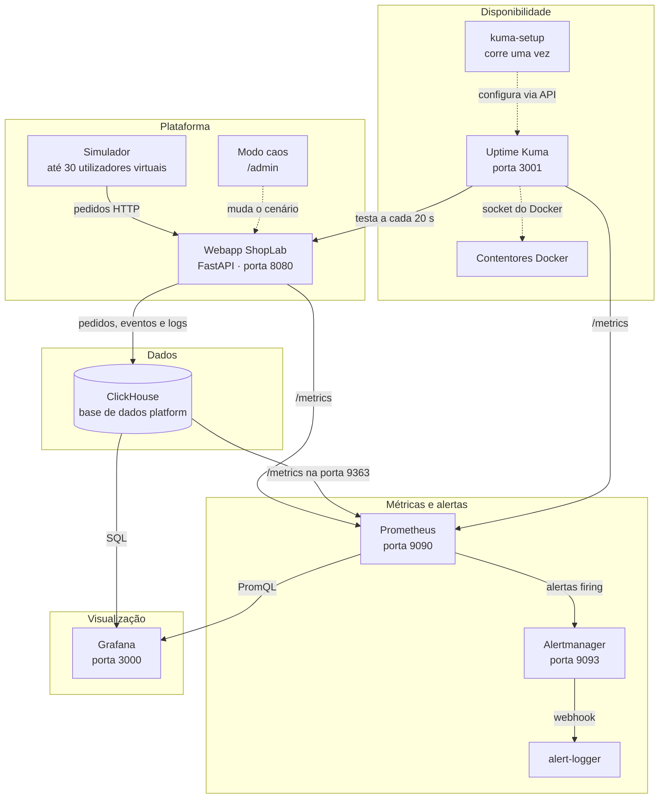
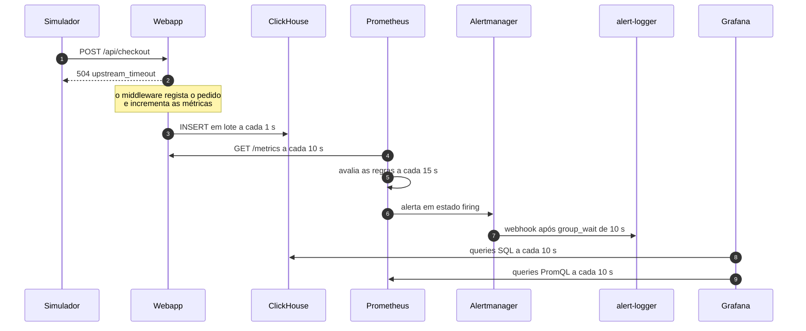
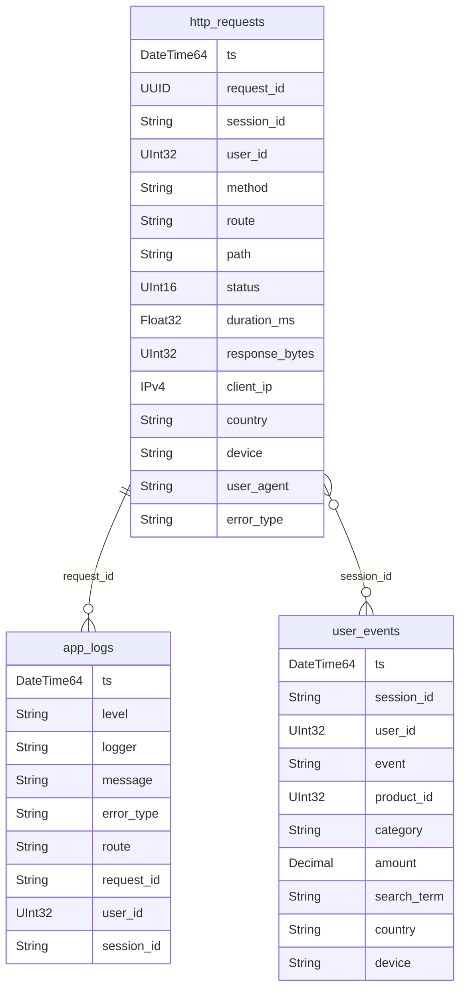
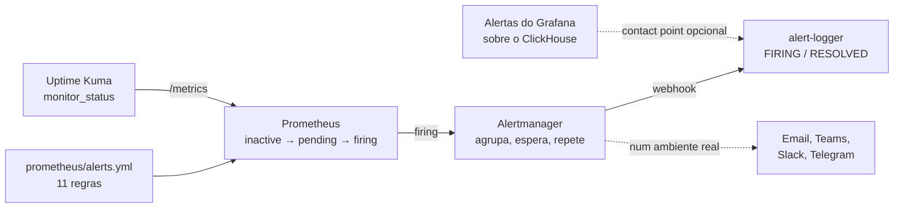
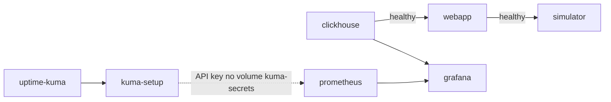

# ShopLab POC · Observabilidade com ClickHouse, Prometheus, Grafana e Uptime Kuma

POC de observabilidade completa para uma plataforma web, a correr localmente em Docker. Uma loja online fictícia (**ShopLab**) é usada por utilizadores simulados; cada pedido, ação e erro fica guardado no **ClickHouse**, as métricas são recolhidas pelo **Prometheus**, os alertas seguem pelo **Alertmanager**, o **Grafana** mostra tudo em dashboards e o **Uptime Kuma** vigia os contentores e a saúde da plataforma de fora.

A stack tem três perspetivas sobre a mesma plataforma:

| Perspetiva | Ferramenta | Pergunta a que responde |
| --- | --- | --- |
| Logs e eventos | ClickHouse + Grafana | O que fizeram os utilizadores e que erros aconteceram, ao detalhe? |
| Métricas e alertas | Prometheus + Alertmanager | A taxa de erros, a latência ou os timeouts passaram o limite? |
| Disponibilidade | Uptime Kuma | Os contentores e os serviços estão de pé e a responder? |

## Índice

- [Arquitetura](#arquitetura)
- [Percurso de um pedido](#percurso-de-um-pedido)
- [Modelo de dados no ClickHouse](#modelo-de-dados-no-clickhouse)
- [Alertas](#alertas)
- [Pôr a plataforma live](#pôr-a-plataforma-live)
- [Configuração](#configuração)
- [Simular incidentes](#simular-incidentes)
- [Comandos úteis](#comandos-úteis)
- [Resolução de problemas](#resolução-de-problemas)
- [Estrutura do repositório](#estrutura-do-repositório)

## Arquitetura



| Componente | Contentor | Papel |
| --- | --- | --- |
| Simulador | `shoplab-simulator` | Utilizadores virtuais que navegam, pesquisam, fazem login, compram; tráfego em ondas de 10 minutos |
| Webapp | `shoplab-webapp` | Loja em Python/FastAPI; grava pedidos, eventos e erros no ClickHouse, expõe `/metrics` e `/health`, tem o modo caos |
| ClickHouse | `shoplab-clickhouse` | Guarda os logs e eventos da plataforma; expõe as suas métricas internas ao Prometheus |
| Prometheus | `shoplab-prometheus` | Recolhe métricas da webapp, do ClickHouse e do Uptime Kuma; avalia 11 regras de alerta |
| Alertmanager | `shoplab-alertmanager` | Agrupa, evita repetições e encaminha os alertas |
| alert-logger | `shoplab-alert-logger` | Recebe os alertas por webhook e imprime `[FIRING]` / `[RESOLVED]` (substitui email, Teams, Slack) |
| Grafana | `shoplab-grafana` | Dashboards "Atividade da Plataforma" (ClickHouse) e "Infraestrutura" (Prometheus) |
| Uptime Kuma | `shoplab-uptime-kuma` | Vigia 7 contentores e 8 endpoints; publica a página de estado |
| kuma-setup | `shoplab-kuma-setup` | Configura o Uptime Kuma automaticamente (conta, monitores, página de estado, API key) e termina |

## Percurso de um pedido

Um pedido de um utilizador simulado atravessa toda a stack e pode acabar num alerta em cerca de 1 a 2 minutos.



Correm dois tipos de dados lado a lado:

- **Logs e eventos** (ClickHouse): cada pedido individual, com utilizador, sessão, país, dispositivo, duração e mensagem de erro. Servem para investigar e para analytics de negócio (funil, receita).
- **Métricas** (Prometheus): contadores agregados por rota e código de resposta. São leves e rápidas, e servem para alertar.

## Modelo de dados no ClickHouse

O schema é criado no primeiro arranque por `clickhouse/initdb/01_schema.sql`, na base de dados `platform`.



| Tabela | Uma linha por | Ordenação (`ORDER BY`) |
| --- | --- | --- |
| `http_requests` | Pedido HTTP à plataforma | `(route, ts)` |
| `user_events` | Ação de utilizador: `login_success`, `view_product`, `add_to_cart`, `checkout_started`, `purchase`, ... | `(event, ts)` |
| `app_logs` | Linha de log INFO, WARN ou ERROR | `(level, ts)` |

Todas usam `MergeTree`, partição por dia (`toYYYYMMDD(ts)`) e TTL de 7 dias. As colunas com poucos valores distintos (rota, país, tipo de erro, nível) são `LowCardinality(String)`.

Utilizadores do ClickHouse:

| Utilizador | Password | Permissões | Usado por |
| --- | --- | --- | --- |
| `admin` | `admin123` | Total | Administração e exploração |
| `shoplab_app` | `app123` | Ler e escrever em `platform` | Webapp |
| `grafana` | `grafana123` | Só leitura em `platform` e `system` | Grafana e Uptime Kuma |

## Alertas



| Regra | Condição | Tempo mínimo | Gravidade |
| --- | --- | --- | --- |
| `PlataformaTaxaErrosAlta` | Erros 5xx acima de 5% dos pedidos (janela de 2 min) | 1 min | critical |
| `PlataformaLenta` | Latência p95 acima de 1 s | 2 min | warning |
| `PlataformaTimeouts` | Mais de 3 respostas 504 por minuto | 1 min | warning |
| `PlataformaForcaBrutaLogin` | Mais de 60 logins falhados por minuto | 1 min | critical |
| `PlataformaSemTrafego` | Nenhum pedido em 2 min | 2 min | warning |
| `PlataformaInacessivel` | O Prometheus não consegue ler a webapp | 1 min | critical |
| `ClickHouseDown` | O Prometheus não consegue ler o ClickHouse | 1 min | critical |
| `ClickHouseTooManyParts` | Mais de 300 parts numa partição | 5 min | warning |
| `ClickHouseHighMemory` | ClickHouse acima de 1,5 GB de memória | 5 min | warning |
| `MonitorEmBaixo` | Um monitor do Uptime Kuma está DOWN | 30 s | critical |
| `UptimeKumaSemMetricas` | O Prometheus não consegue ler o Uptime Kuma | 5 min | warning |

## Pôr a plataforma live

### Pré-requisitos

- Docker Engine com Docker Compose v2 a correr. No Windows 11, Docker Desktop com o motor WSL 2 e **contentores Linux**.
- 4 GB de RAM disponíveis para o Docker (6 GB recomendado) e 10 GB de disco livre.
- Acesso à internet no primeiro arranque (imagens, pacotes Python e o plugin ClickHouse do Grafana).
- Portas livres no host: `3000`, `3001`, `8080`, `8123`, `9090`, `9093`, `9363`.

No Windows, corre todos os comandos no **PowerShell**. O Git Bash converte o caminho `/var/run/docker.sock` e impede o Uptime Kuma de monitorizar os contentores.

### Ordem de arranque

O Docker Compose arranca os serviços pela ordem das dependências. O Alertmanager e o alert-logger arrancam de forma independente.



### Passos

**1. Entrar na pasta do projeto**

```powershell
cd $HOME\shoplab-poc
```

**2. (Opcional) Ajustar a configuração**

Para um POC, os valores por omissão funcionam. Antes do primeiro arranque podes mudar passwords, portas ou o volume de tráfego (ver [Configuração](#configuração)).

**3. Construir e arrancar**

```powershell
docker compose up -d --build
```

Na primeira vez demora 5 a 10 minutos. O Compose constrói as imagens `webapp`, `simulator` e `kuma-setup`, descarrega as restantes e arranca tudo pela ordem acima. No primeiro arranque, o ClickHouse executa o `01_schema.sql` e o kuma-setup configura o Uptime Kuma.

**4. Verificar os contentores**

```powershell
docker compose ps -a
```

Oito serviços devem estar `running`; `shoplab-clickhouse` e `shoplab-webapp` devem estar `(healthy)`. O `shoplab-kuma-setup` deve estar `exited (0)`, porque termina depois de configurar.

```powershell
docker compose logs kuma-setup
```

A última linha deve ser `Configuração do Uptime Kuma concluída.`

**5. Verificar que os dados estão a fluir**

```powershell
docker compose logs simulator
docker exec shoplab-clickhouse clickhouse-client --user admin --password admin123 -q "SELECT count() FROM platform.http_requests"
```

O contador deve subir entre execuções. Em http://localhost:9090/targets, os cinco jobs devem estar `UP`.

**6. Abrir as interfaces**

| Serviço | URL | Credenciais |
| --- | --- | --- |
| Loja ShopLab | http://localhost:8080 | — |
| Modo caos | http://localhost:8080/admin | — |
| Grafana | http://localhost:3000 | `admin` / `admin123` |
| Uptime Kuma | http://localhost:3001 | `admin` / `ShopLab2026!` |
| Página de estado | http://localhost:3001/status/shoplab | — |
| Prometheus | http://localhost:9090 | — |
| Alertmanager | http://localhost:9093 | — |
| ClickHouse (consola web) | http://localhost:8123/play | `admin` / `admin123` |

O Grafana abre diretamente no dashboard "ShopLab · Atividade da Plataforma"; o "Infraestrutura" está em Dashboards → ShopLab.

**7. Seguir os alertas**

Num segundo terminal:

```powershell
docker compose logs -f alert-logger
```

## Configuração

Todas as alterações são feitas nos ficheiros do projeto e aplicadas com os comandos indicados.

| O que mudar | Ficheiro | Como aplicar |
| --- | --- | --- |
| Volume de tráfego (`USERS`), ciclo das ondas (`WAVE_MINUTES`), timeout do cliente (`CLIENT_TIMEOUT`) | `docker-compose.yml`, serviço `simulator` | `docker compose up -d simulator` |
| Portas expostas no host | `docker-compose.yml`, número da esquerda em `ports` | `docker compose up -d` |
| Regras de alerta (condição, limite, tempo, texto) | `prometheus/alerts.yml` | `curl.exe -X POST http://localhost:9090/-/reload` |
| Alvos e intervalos de recolha | `prometheus/prometheus.yml` | `curl.exe -X POST http://localhost:9090/-/reload` |
| Destino das notificações, agrupamento, repetição | `alertmanager/alertmanager.yml` | `docker compose restart alertmanager` |
| Dashboards do Grafana | `grafana/dashboards/*.json` | Recarregados automaticamente em segundos |
| Datasources do Grafana | `grafana/provisioning/datasources/datasources.yml` | `docker compose restart grafana` |
| Monitores do Uptime Kuma criados automaticamente | `kuma-setup/setup_kuma.py` | `docker compose up -d --build kuma-setup` (só cria os que faltam) |
| Modos caos e erros da plataforma | `webapp/app.py`, dicionário `CHAOS_MODES` | `docker compose up -d --build webapp` |
| Schema do ClickHouse | `clickhouse/initdb/01_schema.sql` | `docker compose down -v` e `docker compose up -d --build` (só corre com o volume vazio) |

No Linux ou macOS, usa `curl` em vez de `curl.exe`.

### Mudar passwords

As passwords estão repetidas em vários ficheiros e têm de ser mudadas em todos. As do ClickHouse só são aplicadas com o volume vazio, por isso muda-as antes do primeiro arranque ou faz `docker compose down -v` depois.

| Password | Onde mudar |
| --- | --- |
| ClickHouse `admin` | `docker-compose.yml` (`CLICKHOUSE_PASSWORD`) |
| ClickHouse `shoplab_app` | `clickhouse/initdb/01_schema.sql` e `docker-compose.yml` (`CH_PASSWORD` da webapp) |
| ClickHouse `grafana` | `clickhouse/initdb/01_schema.sql`, `grafana/provisioning/datasources/datasources.yml` e `FRESH_URL` em `kuma-setup/setup_kuma.py` |
| Grafana `admin` | `docker-compose.yml` (`GF_SECURITY_ADMIN_PASSWORD`); só se aplica com o volume `grafana-data` vazio |
| Uptime Kuma `admin` | `docker-compose.yml` (`KUMA_PASSWORD` do kuma-setup); só se aplica com o volume `uptime-kuma-data` vazio |

### Ligar um canal de notificação real

Substitui ou acrescenta ao receiver em `alertmanager/alertmanager.yml`. Exemplo para o Microsoft Teams:

```yaml
receivers:
  - name: logger
    webhook_configs:
      - url: http://alert-logger:5001/
        send_resolved: true
    msteams_configs:
      - webhook_url: https://o-teu-webhook-do-teams
        send_resolved: true
```

## Simular incidentes

Escolhe um cenário em http://localhost:8080/admin ou com o script:

```powershell
powershell -ExecutionPolicy Bypass -File .\scripts\chaos.ps1 -Mode errors
```

| Modo | O que provoca | Grafana | Uptime Kuma | Alerta esperado |
| --- | --- | --- | --- | --- |
| `errors` | 25% dos pedidos dão erro 500 | Faixa 5xx sobe; logs de deadlocks e exceções | "Saúde da plataforma" DOWN | `PlataformaTaxaErrosAlta`, `MonitorEmBaixo` |
| `slow` | 0,6 a 2,5 s de latência extra | p95 e p99 disparam | "Saúde da plataforma" DOWN | `PlataformaLenta`, `MonitorEmBaixo` |
| `timeouts` | 70% das chamadas ao gateway de pagamento dão 504 | Gráfico de timeouts sobe; funil cai no checkout | Em geral verde | `PlataformaTimeouts` |
| `attack` | Bots fazem força bruta ao login | Logins falhados disparam; países RU, CN, KP | Verde | `PlataformaForcaBrutaLogin` |
| `outage` | Toda a API devolve 503 | Quase tudo a vermelho | "Saúde da plataforma" DOWN | `PlataformaTaxaErrosAlta`, `MonitorEmBaixo` |
| `normal` | Funcionamento normal (cerca de 1% de erros) | Recupera | Tudo verde | `[RESOLVED]` |

Os alertas chegam ao alert-logger em cerca de 1 a 2 minutos. Também podes parar serviços para testar: `docker compose stop simulator` (dispara `PlataformaSemTrafego`), `docker compose stop clickhouse` (`ClickHouseDown`) ou `docker compose stop webapp` (`PlataformaInacessivel`), e repor com `docker compose start <serviço>`.

## Comandos úteis

| Para | Comando |
| --- | --- |
| Ver o estado dos contentores | `docker compose ps -a` |
| Resumo de saúde da plataforma | `powershell -ExecutionPolicy Bypass -File .\scripts\status.ps1` |
| Seguir os alertas | `docker compose logs -f alert-logger` |
| Seguir o tráfego simulado | `docker compose logs -f simulator` |
| Consola SQL do ClickHouse | `docker exec -it shoplab-clickhouse clickhouse-client --user admin --password admin123` |
| Validar as regras de alerta | `docker exec shoplab-prometheus promtool check rules /etc/prometheus/alerts.yml` |
| Parar tudo e manter os dados | `docker compose down` |
| Apagar tudo e recomeçar do zero | `docker compose down -v` |

## Resolução de problemas

| Sintoma | Causa provável | Solução |
| --- | --- | --- |
| `port is already allocated` | Outra aplicação usa a porta | Mudar o número da esquerda em `ports` no `docker-compose.yml` |
| `shoplab-kuma-setup` em `exited (1)` | O Uptime Kuma ainda não estava pronto | `docker compose up -d kuma-setup` |
| Monitores de contentores DOWN com erro de Docker | O Uptime Kuma não chega ao socket do Docker | Arrancar a partir do PowerShell; confirmar com `docker exec shoplab-uptime-kuma ls -l /var/run/docker.sock` |
| Target `uptime-kuma` DOWN no Prometheus | API key em falta | Correr de novo o kuma-setup |
| Grafana sem a datasource ClickHouse | O plugin não foi descarregado | Verificar a ligação à internet e `docker compose restart grafana` |
| Dashboards vazios | Ainda sem dados, ou simulador parado | Esperar 1 a 2 minutos; ver `docker compose logs simulator` |
| Alteração a um ficheiro de configuração não aplicada | O Docker Desktop não refletiu o ficheiro no contentor | `docker compose restart <serviço>` |
| Script `.ps1` bloqueado | Política de execução do Windows | Correr com `powershell -ExecutionPolicy Bypass -File ...` |

## Estrutura do repositório

```text
shoplab-poc/
├── docker-compose.yml              # os 9 serviços, portas, volumes e dependências
├── alert-logger/
│   └── alert_logger.py             # recetor de webhooks que imprime os alertas
├── alertmanager/
│   └── alertmanager.yml            # encaminhamento e agrupamento dos alertas
├── clickhouse/
│   ├── config.d/prometheus.xml     # ativa /metrics na porta 9363
│   └── initdb/01_schema.sql        # base de dados, tabelas e utilizadores
├── grafana/
│   ├── dashboards/                 # platform.json e infra.json
│   └── provisioning/               # datasources e carregamento dos dashboards
├── kuma-setup/
│   ├── Dockerfile
│   └── setup_kuma.py               # configura o Uptime Kuma via API
├── prometheus/
│   ├── prometheus.yml              # alvos de recolha
│   └── alerts.yml                  # 11 regras de alerta
├── scripts/
│   ├── chaos.ps1                   # muda o modo caos
│   └── status.ps1                  # resumo de estado
├── simulator/
│   ├── Dockerfile
│   └── simulator.py                # utilizadores virtuais e bots
└── webapp/
    ├── Dockerfile
    ├── requirements.txt
    └── app.py                      # a loja ShopLab
```

> Todas as passwords deste projeto são de demonstração. Não exponhas estas portas fora da máquina local.
